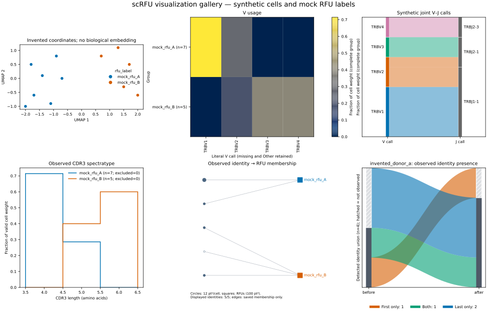

# Dataset-independent visualization

The five V(D)J views below are **unreleased 0.5 development APIs**. They consume
saved observations and RFU assignments. They never assign RFUs, infer primary
chains, compute embeddings, call clones or fit sequence distances. Existing
`scrfu.pl` functions retain their previous contracts.

Install the development checkout with `python -m pip install '.[plotting]'`.
The published v0.4.1 does not include these additions. Matplotlib remains the
only plotting-extra dependency; importing `scrfu` and preparing tables works
without it. Scanpy, Scirpy, MuData, Dandelion, NetworkX and Logomaker are not
required for canonical-table plots.

Every `scrfu.pl` function accepts `ax=None`, creates or draws on a Matplotlib
Axes, and returns that Axes. It does not save or call `show()`. Save the composed
figure explicitly. Input tables and objects remain unchanged.

## From scratch: synthetic gallery

The runnable example is `examples/vdj_plotting.py` in this source checkout. It creates twelve invented cells, short
mock receptor strings, deliberately specified mock RFUs and invented coordinates.
It runs no biological embedding or RFU model. No participant data are used.

```bash
python examples/vdj_plotting.py --outdir /tmp/scrfu-synthetic-gallery
```



A small canonical example can also be constructed directly:

```python
import pandas as pd
import matplotlib.pyplot as plt
import scrfu

rows = pd.DataFrame({
    "cell_id": ["invented_a", "invented_b", "invented_c"],
    "chain": ["TRB"] * 3,
    "cdr3aa": ["CAAF", "CAAF", "CGGAF"],
    "v_call": ["TRBV1", "TRBV1", "TRBV2"],
    "j_call": ["TRBJ1-1"] * 3,
    "rfu_label": ["mock_A"] * 3,  # deliberately specified, not inferred
    "donor": ["invented_subject"] * 3,
    "visit": ["before", "after", "after"],
})
prepared = scrfu.tl.prepare_receptor_plot_data(rows, unit="cell")
fig, axes = plt.subplots(1, 3, figsize=(12, 3.5), layout="constrained")
scrfu.pl.rfu_vj_usage(prepared, groupby="rfu_label", ax=axes[0])
scrfu.pl.rfu_cdr3_spectratype(prepared, ax=axes[1])
scrfu.pl.rfu_membership_network(prepared, ax=axes[2])
fig.savefig("my_synthetic_composition.svg")  # explicit caller action
```

## Inputs, identifiers and units

`tl.prepare_receptor_plot_data()` is the common preparation entry point. The
plot-specific preparers return typed results containing counts, denominators
and audits. Preparation parameters on plotting functions apply to raw input;
when passing a prepared result, change its preparation explicitly instead.
The prepared result is authoritative; a contradictory `unit` raises. inspect them before drawing. Each public plot also accepts raw
input under the default single-TRB policy. Use prepared input for other loci,
read weighting, primary-chain flags, or explicit metadata joins.

| Policy | Meaning |
| --- | --- |
| `unit="cell"` (default) | One selected receptor record per unique cell; ambiguous repeated cells raise. |
| `unit="receptor"` | One exact tuple of `identity_cols` per plotted group (and per donor/visit for longitudinal views). The same identity in two groups contributes once to each. |
| `unit="read"` | Sum a supplied `read_count_col`; finite nonnegative integer counts and unique `record_id_col` are required. Row multiplicity and UMI counts are never inferred to be reads. |
| `chain="TRB"` (default) | Select that locus explicitly. `chain=None` retains all rows of an already selected table, including tables without a chain field. |
| `productive_only=False` | No implicit productivity assumption. Enable explicitly when source productivity is available. |
| `multi_chain="error"` | Repeated cell IDs after locus/productivity selection raise, including duplicated copies of the same record. |
| `multi_chain="primary"` | `primary_col` must mark exactly one retained source receptor per represented cell. No primary chain is inferred. |
| `multi_chain="all"` | Retain all chains in receptor/read modes only. Include locus in `identity_cols` when pooling loci. |
| `qualified_only=False` | No automatic score threshold. To use saved qualification, specify `qualified_only=True` and the saved boolean `qualification_col`. |

IDs are joined exactly, without positional matching or string coercion. Barcode
reuse across samples must first be resolved with explicit composite cell IDs.
Missing/blank IDs, duplicate record IDs, empty selections and invalid weights
raise diagnostics. Cell metadata must cover every receptor cell. Receptor-level
columns take precedence; only additional metadata columns are joined.

```python
# Native AnnData or MuData with saved scRFU chain-aligned assignments:
prepared = scrfu.tl.prepare_receptor_plot_data(
    mdata, airr_mod="airr", airr_key="airr", assignment_key="scrfu",
    chain="TRB", multi_chain="primary", primary_col="saved_primary",
    qualified_only=True, qualification_col="threshold_pass",
)
# saved_primary must already exist on source AIRR records; it is not computed.
# Use multi_chain="all", unit="receptor", identity_cols=[...] to retain all chains.

# Explicitly selected receptor fields already in adata.obs:
prepared = scrfu.tl.prepare_receptor_plot_data(adata, airr_key=None)

# A generic AIRR DataFrame uses explicit aliases; retain literal calls yourself:
canonical = airr_table.rename(columns={"locus": "chain", "junction_aa": "cdr3aa"})
prepared = scrfu.tl.prepare_receptor_plot_data(canonical, chain="TRB")
```

Native AIRR preparation reuses scRFU's canonical adapter and saved-schema
validation, then restores literal V/J and sequence fields. It verifies chain
index and locus alignment. It never broadcasts an `.obs` RFU summary onto
multiple AIRR chains. Existing `AdapterResult` inputs are also accepted; any
normalization previously performed by that adapter remains the caller's
responsibility. MuData requires its optional package; Awkward is required only
for native jagged AIRR storage. Neither is a new core requirement.

## Existing embedding: `pl.rfu_umap`

```python
ax = scrfu.pl.rfu_umap(adata, basis="X_umap", color="cell_type")
ax = scrfu.pl.rfu_umap(adata, color="rfu_label", highlight=["chosen_rfu"])
# For MuData choose the RNA modality explicitly, e.g. modality="rna".
# For arrays pass coordinates=xy, cell_ids=ids, metadata=metadata.
# For an indexed coordinate DataFrame its index supplies the IDs.
```

The preparer `tl.prepare_rfu_embedding()` preserves existing finite 2-D
coordinates and coordinate order. Metadata are reindexed by exact identifiers;
extra cells raise, and missing metadata raises unless
`allow_missing_metadata=True` explicitly preserves missing categories. No
expression matrix is accessed. Qualification colors require a saved boolean
`qualification_col`; optional `eligible_col` distinguishes ineligible cells.
`display_cells` and `highlight` affect drawing only. An enriched display is not
an abundance denominator. Use complete source tables for all quantitative plots.
For comparable panels, set identical limits explicitly on the returned axes.

## V/J usage: `pl.rfu_vj_usage`

```python
usage = scrfu.tl.prepare_rfu_vj_usage(prepared, groupby="rfu_label")
assert usage.v_counts.sum(axis=1).equals(usage.denominators)
scrfu.pl.rfu_vj_usage(usage, segment="v")
scrfu.pl.rfu_vj_usage(usage, segment="j")
scrfu.pl.rfu_vj_usage(usage, style="ribbon", group="chosen_rfu")
```

`groupby` can name any complete metadata field, including donor, sample or cell
type. `group_order` must contain every group. All literal source calls appear
by default: allele suffixes, ambiguous multi-call strings and source resolution
are not split, rounded or inferred. No D calls are generated. Missing V/J
columns, NA or empty calls have explicit `Missing V`/`Missing J` categories.
At least one call column is required. Reserved category-name collisions raise.

`top_n=N` selects V and J categories separately by their total weight across
all included groups, with natural then lexical tie-breaking. Remaining mass
appears in `Other V`/`Other J`; missing categories are always retained. Inspect
`literal_pairs`, `pairs`, `v_counts`, `j_counts`, `denominators` and the audit's
category mappings. Frequencies divide by **all selected weight in each group**,
including missing and Other calls. A common category set allows fair comparison;
use no limit when genes important in a small group would otherwise be hidden.
Unique-receptor weighting rejects identities with multiple V/J pairs within a
group; use a finer identity definition or cell/read weighting instead.

## CDR3 lengths: `pl.rfu_cdr3_spectratype`

```python
spectrum = scrfu.tl.prepare_rfu_cdr3_spectratype(
    prepared, groupby="rfu_label", sequence_col="cdr3aa", invalid="error",
)
scrfu.pl.rfu_cdr3_spectratype(spectrum)
```

Lengths come from actual uppercase unambiguous 20-letter amino-acid sequences.
No translation, trimming, padding or inferred length is used. NA/empty sequences
are excluded and counted. Invalid sequences (including gaps, stops, ambiguous
letters and lowercase) raise unless `invalid="exclude"` records their excluded
weight. The default bins center on integer lengths; a bin count or explicit
edges is allowed. Edges must cover every valid length; the final right edge is
inclusive. Normalization uses valid-sequence weight, with `input_denominators`
and separate missing/invalid `excluded` weights available for reconciliation.
Duplicate sequences contribute per cell/read unless unique-receptor mode was
explicitly prepared; identity definitions remain explicit.

## Confirmed membership: `pl.rfu_membership_network`

```python
membership = scrfu.tl.prepare_rfu_membership(
    prepared, identity_cols=["cdr3aa", "v_call"], donor_col="donor",
)
scrfu.pl.rfu_membership_network(membership, layout="bipartite", max_per_rfu=12)
# Nucleotide-resolved alternative, if these fields exist:
nt_membership = scrfu.tl.prepare_rfu_membership(
    prepared, identity_cols=["v_call", "j_call", "junction"],
)
```

Default receptor identity is the exact literal AA CDR3 + V tuple. Nucleotide
identity requires explicit nucleotide and gene columns. A conventional clonotype
requires an independently established clonotype column and documented chain,
identity and distance rules. **None of these definitions is interchangeable.**
The default AA+V identity is not a paired alpha/beta clonotype.

Each edge denotes a confirmed saved assignment only. It represents neither
sequence distance, lineage, physical interaction, functional equivalence nor
shared antigen recognition. Missing RFUs are excluded and their weight audited;
missing identity components raise. Conflicting RFUs for an identity raise unless
`allow_multiple_rfus=True` explicitly permits them. Mixed saved reference
identities are rejected. If no reference identifier is supplied, correspondence
is the caller's responsibility; RFU numbers alone do not establish it.

Circles are observed identities, with area proportional to the chosen abundance
unit. Squares are RFUs with fixed area. The legend reports the exact scale in
points squared. `max_per_rfu` chooses highest abundance then deterministic node-ID
ties; `receptor_nodes` allows explicit selection. Both are display limits, leaving
complete nodes/edges/counts untouched. Node IDs are aliases, not sequences.
Bipartite and radial layouts are deterministic; radial requires one RFU per
identity. Custom positions do not change edge meaning.

Scirpy clonotype analysis is complementary: preserve its independently computed
clone definition and pass its identifier explicitly if that is the intended
unit. Dandelion-style sequence-distance networks require separately defined
sequence/clone distances and suitable source contigs. RFU membership edges cannot
substitute for those distances. This API includes no Dandelion backend or clone
inference and adds no such dependency.

## Ordered presence: `pl.rfu_longitudinal_presence`

```python
presence = scrfu.tl.prepare_rfu_longitudinal_presence(
    prepared, sample_col="visit", sample_order=["before", "after"],
    donor_col="donor", identity_cols=["cdr3aa", "v_call"], min_count=1,
)
scrfu.pl.rfu_longitudinal_presence(presence, donor="chosen_subject", style="alluvial")
scrfu.pl.rfu_longitudinal_presence(
    presence, donor="chosen_subject", measure="abundance", normalize=True,
)
```

Sample order is mandatory and exhaustive. Donors remain separate when
`donor_col` is supplied; omitting it explicitly pools observations. Multiple
donors require an explicit plot selection. Missing visits remain NaN/blank,
never observed zero. Supply `sample_metadata` with unique donor/sample
combinations to declare collected visits that have zero included observations.
Missing identity fields are excluded with an audit or rejected via
`missing_identity="error"`.

Heatmap abundance denominators are all included identity-bearing weight per
donor/sample, before `min_count` detection or display limiting. Presence is
binary at the chosen threshold in the selected unit. Two-visit alluvials require
both visits to be observed and count distinct detected identities in their
union: first only, both, last only. Their ribbon denominator is **identities in
the union**, never cells or reads. Hatching denotes identities not detected at
that endpoint, not uncollected visits. This is descriptive observed presence;
shared RFU presence is not clonal persistence or evidence of treatment causality.

## Existing plots

The existing abundance, score, metric, overlap, convergence, phenotype,
repertoire-comparison, antigen-evidence and regulatory plotting functions remain
available. Their contracts and signatures are unchanged. In particular, the
existing longitudinal analysis results retain their original semantics; the new
presence views do not replace inference, resampling or transfer methods.
`tl.rfu_sequence_matrix()` remains the optional logo foundation. Motifs and RFU
membership do not establish biological function without independent validation.
